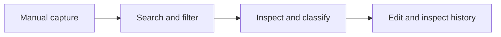

# SignalDesk

**An authenticated feedback inbox for capturing, finding, manually classifying,
and editing synthetic customer feedback with workspace permissions and audit
history.**

SignalDesk is a TypeScript portfolio project built with Next.js, NestJS,
PostgreSQL, and TypeORM. The implemented slice focuses on a reliable manual
feedback workflow.

> Status: The repository implements a locally runnable manual feedback
> workflow and documents a protected EC2 development deployment.
> The next phase adds Terraform-managed AWS infrastructure, resilient
> event processing, webhook ingestion, and portfolio demonstrations.
> These additions are planned; AI suggestions remain disabled.
> See the [evolution plan](docs/EVOLUTION_PLAN.md).

## Review the project

- [Local setup](#run-locally)
- [Case study](docs/CASE_STUDY.md)
- [Architecture](docs/ARCHITECTURE.md)
- [Data model](docs/DATA_MODEL.md)
- [AI-assisted development examples](docs/AI_ASSISTED_EXAMPLES.md)
- [Usability and performance evidence](docs/operations/WEEK7_HARDENING.md)
- [Operational verification limits](docs/operations/WEEK6_CLOSEOUT.md%3A)

Usability findings are developer-reported; external participants were
unavailable. Protected-deployment verification limitations remain visible.

## Run locally

Requirements: Node.js 24 and Docker.

For initial setup, work from the repository root. Create `.env` from `.env.example` only if you do not already have one:

```sh
cp .env.example .env
```

Before continuing, edit `.env`: set `BETTER_AUTH_SECRET` to a random secret of at least 32 characters and choose separate `DEV_EDITOR_PASSWORD` and `DEV_VIEWER_PASSWORD` values. Keep `.env` out of Git and never reuse these local credentials for the protected deployment. Then run:

```sh
npm ci
docker compose up -d --wait postgres
npm run build --workspace=apps/api
env -u DATABASE_URL node --env-file=.env node_modules/typeorm/cli.js migration:run -d apps/api/dist/data-source.js
docker compose exec -T postgres psql -U signaldesk -d signaldesk < apps/api/db/seed.sql
env -u DATABASE_URL -u BETTER_AUTH_SECRET -u BETTER_AUTH_URL -u DEV_EDITOR_EMAIL -u DEV_EDITOR_PASSWORD -u DEV_VIEWER_EMAIL -u DEV_VIEWER_PASSWORD node --env-file=.env apps/api/scripts/seed-dev-accounts.mjs
```

For later starts, the database volume already contains the schema, feedback, and accounts. Start PostgreSQL with `docker compose up -d --wait postgres`; do not recreate `.env` or rerun the seeds. Rebuild the API after changing its source code.

Start the API in one terminal from the repository root and leave it running:

```sh
env -u DATABASE_URL -u BETTER_AUTH_SECRET -u BETTER_AUTH_URL node --env-file=.env apps/api/dist/main.js
```

Start the web app in another terminal and leave it running:

```sh
env -u API_BASE_URL npm run dev --workspace=apps/web
```

Open `http://localhost:3000/sign-in`. Sign in with `DEV_EDITOR_EMAIL` and `DEV_EDITOR_PASSWORD` from `.env` to create feedback. Sign out, then use the viewer credentials to confirm the feedback is visible without a create form. The web app uses `http://localhost:3001` for the API by default. API documentation is available at `http://localhost:3001/api`.

`BETTER_AUTH_URL` must exactly match the browser origin, including its port.
If the web app runs on port 3002, use `http://localhost:3002` and restart
the API after changing the setting. Protected deployment configuration
is separate; see the deployment runbook.

To verify persistence, stop **only the API** with Ctrl-C, start it again, and reload the web page. The feedback should still be there because PostgreSQL stores it in the Docker volume.

For API integration tests, use the separate `signaldesk_test` database. Never point those tests at the development database. To verify the protected EC2 deployment, follow [the deployment runbook](docs/DEPLOYMENT.md).

## The problem

Customer feedback arrives through support conversations, sales notes, surveys, reviews, and internal messages. Product teams often lose the context, duplicate the same request, or prioritize the loudest customer rather than the strongest evidence.

The implemented workflow supports:

1. Manually capture synthetic feedback.
2. Find records through search, product-area/tag filters, and pagination.
3. Inspect and manually classify feedback by product area and tags.
4. Edit text with stale-write protection and inspect audit history.
5. Enforce editor/viewer permissions and workspace boundaries through the API.



CSV imports, customer/sentiment classification, clustering, opportunities,
prioritization, decisions, and outcome tracking are future product scope.
AI suggestions remain deferred and disabled.

## Who it is for

- Product managers who need traceable evidence for roadmap decisions.
- Product engineers who need customer context behind planned work.
- Founders who need a lightweight view of emerging demand.
- Support, success, and sales teams who want feedback to reach product teams.

## Engineering evidence

- API-enforced editor/viewer permissions and workspace isolation.
- Transactional audit events, idempotent capture, and stale-edit rejection.
- PostgreSQL integration tests and a critical Playwright browser journey.
- Developer-reported keyboard and zoom checks, with participant limitations.
- A reproducible inbox-query investigation supporting a pagination index.
- Correlated request logs, readiness checks, and isolated recovery rehearsals.

See [Week 7 evidence](docs/operations/WEEK7_HARDENING.md) for measured
results and limitations.

## Implemented stack

- **Web:** Next.js, React, TypeScript.
- **API:** NestJS, REST, and an OpenAPI-derived frontend contract.
- **Data:** PostgreSQL and reviewed TypeORM migrations.
- **Verification:** Vitest, PostgreSQL integration tests, and Playwright.
- **Operations:** Docker Compose, GitHub Actions, correlated logs, bounded
  frontend failure reporting, and separate liveness/readiness checks.

Monitoring is operator-reviewed. External alerts and durable log collection
are deferred. Redis, BullMQ, live updates, and product analytics are outside
the implemented slice.

## Documentation

| Document                                             | Purpose                                                           |
| ---------------------------------------------------- | ----------------------------------------------------------------- |
| [Product brief](docs/PRODUCT_BRIEF.md)               | Users, jobs, scope, workflows, and success measures               |
| [Architecture](docs/ARCHITECTURE.md)                 | System boundaries, data flow, reliability, and security           |
| [Data model](docs/DATA_MODEL.md)                     | Core entities, relationships, and invariants                      |
| [8-week roadmap](docs/ROADMAP.md)                    | 15–20 hours per week of focused delivery and AI-assisted practice |
| [Learning plan](docs/LEARNING_PLAN.md)               | Milestone-aligned curriculum, exit tests, and competency targets  |
| [React live-coding track](docs/REACT_LIVE_CODING.md) | Interview practice mapped into reusable product components        |
| [Quality bar](docs/QUALITY_BAR.md)                   | Definition of done for product and engineering work               |
| [Portfolio evidence](docs/PORTFOLIO_EVIDENCE.md)     | What hiring managers should be able to verify                     |
| [Backlog](docs/BACKLOG.md)                           | MVP epics and acceptance outcomes                                 |
| [Decision records](docs/decisions/)                  | Important decisions and their trade-offs                          |

## Delivery principles

1. Ship a narrow vertical slice before expanding breadth.
2. Build interview exercises as reusable, production-quality components.
3. Measure behavior and performance instead of relying on adjectives.
4. Treat failure states, permissions, accessibility, and observability as product features.
5. Keep claims in the case study traceable to code, tests, or measured results.

## Eight-week target

Ship an authenticated, deployed feedback inbox with persistent capture, search/filtering, manual classification, reliable editing, tenant isolation and audit evidence. Verify it with tests, monitoring, usability/accessibility checks and one performance investigation. Demonstrate AI-assisted engineering through reviewed changes and documented corrections every week.

AI classification suggestions are a conditional Week 5 experiment with human approval and evaluation. If the core workflow is unstable after Week 4, defer the experiment. CSV imports, queues, live updates, clustering, scoring and elaborate membership administration remain outside this deadline.

The budget is 15–20 hours weekly. This is a capability and portfolio target, not a promise of employment or senior full-stack expertise. See [ADR 0002](docs/decisions/0002-eight-week-ai-assisted-delivery.md) for the scope change.

## Complete MVP success criteria

The MVP is successful when a team member can import or enter feedback, find and group related signals, create an opportunity with supporting evidence, record a prioritization decision, and see a complete audit trail. Technical success criteria live in the [quality bar](docs/QUALITY_BAR.md).

## License

[MIT](LICENSE)
