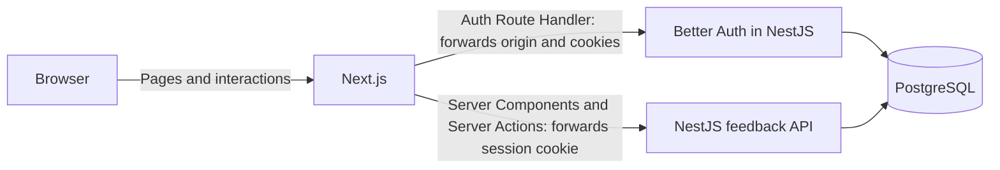

# Architecture

## Implemented scope

SignalDesk implements authenticated feedback capture, search/filtering,
cursor pagination, manual classification, editing, and audit history.

The web interface uses one seeded workspace. The API independently enforces
workspace membership and editor/viewer permissions, including direct requests.

AI suggestions are an implemented experiment but remain disabled and deferred
from the released manual workflow.

## Request boundaries

Next.js owns rendering, forms, URL filter state, and recoverable interaction
states. Authentication Route Handlers relay session cookies between the
browser and API. Protected server requests explicitly forward the session
credential.

NestJS owns session validation, authorization, input validation, transactional
mutations, and persistence. Hiding frontend controls is not authorization.

`BETTER_AUTH_URL` must match the browser origin, including its port.
Public sign-up is disabled; controlled scripts create synthetic accounts.

See [ADR 0004](decisions/0004-authentication-and-workspace-access.md).

## Persistence and integrity

PostgreSQL stores authentication records, workspaces, memberships, feedback,
product areas, tags, feedback/tag relationships, and audit events.

TypeORM uses reviewed migrations with automatic synchronization disabled.
Workspace-aware constraints prevent cross-workspace classification links.

- Feedback creation supports a scoped idempotency key.
- Editing and classification check the expected feedback version.
- Important mutations and their audit events share one transaction.
- Failed audit writes roll back the associated mutation.

Inbox pagination orders by `created_at DESC, id DESC`. An index on
`(workspace_id, created_at DESC, id DESC)` supports that access pattern.
Audit history is ordered but is not cursor-paginated.

Frontend domain types derive from the OpenAPI schema.

## Form state

Successful mutations refresh server-rendered data. Untouched edit and
classification forms adopt refreshed versions. Unsaved drafts retain their
original versions so a refresh cannot silently authorize a stale write.

The browser journey covers capture-error recovery, editing, stale rejection,
manual classification, persistence, audit evidence, and viewer restrictions.

## Operations

The API distinguishes process liveness from PostgreSQL readiness.
Requests have correlated logs, and unexpected API errors are sanitized.
Authentication proxy failures and feedback edit failures expose references.
Page-render failures have bounded, privacy-conscious reporting.

Payload limits, feedback request/write limits, and a shared production
sign-in budget constrain the protected demo. These in-memory limits are
not shared across API instances and reset on restart.

Monitoring is operator-reviewed. External alerts and durable log collection
are deferred. Recovery rehearsals and their limits are recorded in
[operations documentation](operations/WEEK6_CLOSEOUT.md%3A).

## Demo environments

- Local development uses its own configuration and database.
- The local portfolio demo uses Compose project `signaldesk-demo`,
  a separate volume, `signaldesk_test`, and loopback port 3300.
- The guarded local reset restores one feedback record and clears the demo
  workspace's feedback/audit history. Accounts and classification options
  remain.
- The protected EC2 development deployment remains separate.
- Public hosting is deferred; the local demo is not a public release.

Committed demo credentials are disposable local credentials, not deployment
secrets. AI remains disabled.

## Verification and limitations

PostgreSQL integration tests use only `signaldesk_test`.
Automated browser checks complement the developer-reported keyboard and
zoom walkthrough; external participants were unavailable.
Screen-reader announcements were not separately verified.

The performance investigation measures one local inbox query on synthetic
data, not production traffic or end-to-end browser latency.

See [Week 7 evidence](operations/WEEK7_HARDENING.md) for results and limits.

## Planned evolution

The [evolution plan](EVOLUTION_PLAN.md) describes planned Terraform-managed
AWS infrastructure, RabbitMQ, a transactional outbox, separate background
processes, webhook ingestion, and processing visibility.

These components are not part of the implemented architecture described
above. AI enrichment and scheduled insights follow the verified
event-processing release.

See [ADR 0005](decisions/0005-resilient-feedback-platform.md) for the
decision and its tradeoffs.

CSV imports, opportunity scoring, full decision tracking, vector search,
and elaborate membership administration remain outside this phase.
