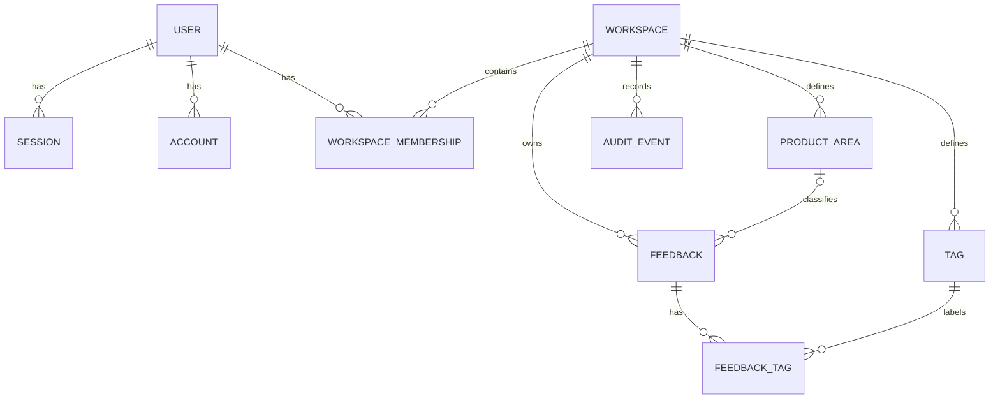

# Data model

## Implemented scope

PostgreSQL stores authentication records, workspace memberships, feedback,
manual classification, and audit events. Reviewed TypeORM migrations are
the schema source of truth; automatic synchronization is disabled.

Customers, imports, opportunities, decisions, sentiment, and feedback status
are not implemented entities or fields. AI suggestions are not persisted
as separate records.

## Tables

| Table                   | Purpose                                                           |
| ----------------------- | ----------------------------------------------------------------- |
| `user`                  | Better Auth identity; text ID, unique email, name                 |
| `session`               | Authentication session, token, expiry, user reference             |
| `account`               | Authentication provider account and credential hash               |
| `verification`          | Better Auth verification storage                                  |
| `workspaces`            | Workspace identity and name                                       |
| `workspace_memberships` | User/workspace pair with editor or viewer role                    |
| `feedback`              | Text, source, timestamps, classification, version, retry identity |
| `product_areas`         | Workspace-owned classification choices                            |
| `tags`                  | Workspace-owned tags                                              |
| `feedback_tags`         | Workspace-safe feedback/tag relationships                         |
| `audit_events`          | Actor, action, feedback reference, before/after snapshots         |

Authentication user IDs are text. Application entity IDs are UUIDs.

## Enforced relationships

Product-area and feedback/tag foreign keys include `workspace_id`, preventing
relationships between records belonging to different workspaces.

`audit_events.feedback_id` and `actor_user_id` are stored identifiers,
not database foreign keys. The application writes them through authorized
transactional mutation paths. The diagram therefore omits those as enforced
foreign-key relationships.

## Feedback fields

| Field                    | Behavior                                                    |
| ------------------------ | ----------------------------------------------------------- |
| `id`                     | UUID primary key                                            |
| `workspace_id`           | Required workspace foreign key                              |
| `source`                 | String; defaults to `manual`                                |
| `content`                | Required text; application validates nonempty bounded input |
| `occurred_at`            | Signal occurrence timestamp                                 |
| `created_at`             | Recording timestamp used for inbox ordering                 |
| `product_area_id`        | Optional workspace-owned product area                       |
| `version`                | Positive integer, initially 1                               |
| `create_request_key`     | Optional UUID for retry-safe creation                       |
| `create_request_user_id` | Optional text identifier scoped to the retry key            |

The request key and user identifier must both be null or both be populated.

## Authorization and integrity

- Membership is unique per workspace/user pair.
- Membership roles are constrained to `editor` or `viewer`.
- Product-area and tag names are unique within their workspace.
- Feedback/tag links are unique per workspace, feedback, and tag.
- API membership checks govern reads; editor checks govern mutations.
- Edit and classification mutations compare the expected version while
  locking the feedback row.
- Successful changes increment the version; unchanged submissions do not
  add another mutation event.
- Feedback mutations and their audit events share one transaction.
- Audit-write failure rolls back the mutation.

Authorization is enforced by the API, not PostgreSQL row-level security.

## Retry identity

A partial unique index on
`(workspace_id, create_request_user_id, create_request_key)`
applies when the request key is populated.

A repeated creation request with the same identity and content returns the
existing feedback. Reusing the key for different content is rejected.

## Audit events

Actions are constrained to `feedback.created`, `feedback.edited`, and
`feedback.classified`. Events store JSONB before/after snapshots and a
recording timestamp.

Audit events are append-only through normal application behavior.
Database permissions do not independently enforce immutability; the guarded
local demo reset explicitly deletes its workspace's history.

## Query indexes

- Inbox: `(workspace_id, created_at DESC, id DESC)`.
- Feedback lookup: unique `(workspace_id, id)`.
- Tag filtering: `(workspace_id, tag_id)` on `feedback_tags`.
- History: `(workspace_id, feedback_id, created_at DESC, id DESC)`.
- Membership lookup: index on `user_id`, alongside its composite primary key.

Inbox pagination uses `(created_at, id)` as its stable cursor boundary.
Text search uses a case-insensitive substring condition; there is no
full-text or vector index.

The inbox index is supported by the
[Week 7 performance investigation](operations/WEEK7_HARDENING.md).
Its measurements do not establish search/filter or production performance.

## Environment boundaries

Database tests use only `signaldesk_test`. Separate Compose projects and
volumes isolate the local demo from development and recovery rehearsals.

The demo reset clears feedback and audit history only for its seeded
workspace, restores one feedback record, and preserves accounts and
classification choices.
